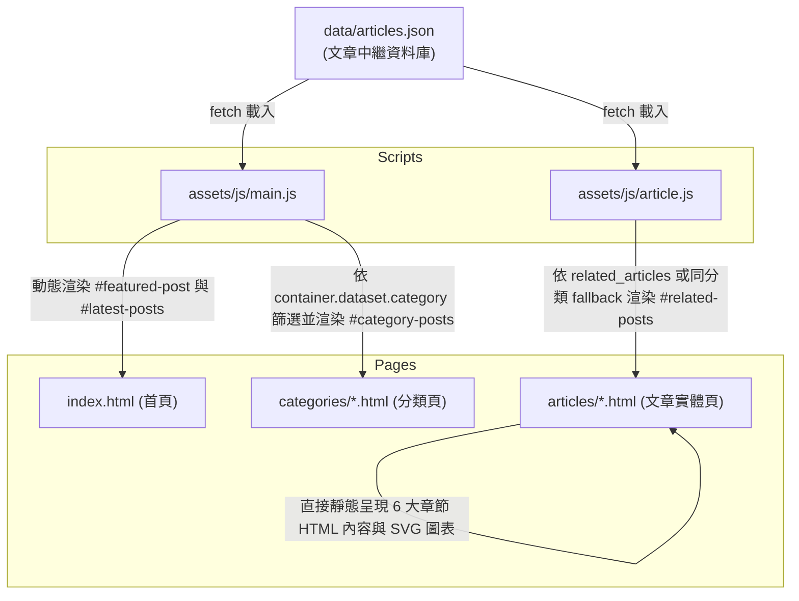
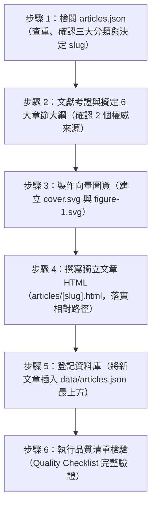

# AGENTS.md — THE STORY LAB（事物探索研究所）專案規範手冊

> **本文件為所有 AI 協作者在維護、擴充與更新「THE STORY LAB（事物探索研究所）」時的最高遵循準則。**  
> 所有新增文章、樣式微調、架構維護與資料庫更新，均必須嚴格符合本手冊規定。AI 在動手修改或建立任何檔案之前，必須先完整閱讀本規範及相關檔案，以確保全站視覺風格、資料結構、超連結與多裝置閱讀體驗的一致性與穩定性。

---

## 1. 專案目的與內容定位（Project Overview）

### 1.1 創立原因與核心理念
在充斥演算法推播、碎片化農場文與速食短影音的當代網路環境中，人們往往習慣了快節奏的資訊消費，逐漸失去對身邊事物的觀察力與好奇心。

我們每天噴灑的香水、穿著的鉚釘牛仔褲、久旱初雨後的泥土芬芳、海洋深處形成的珍珠光澤、或是螢幕前收發的電子郵件——這些看似尋常的日常物件，往往被視為理所當然的存在。然而，每件物品背後，其實都凝結著人類探索世界的科學機理、工藝技術的極限突破、以及漫長迷人的物質文化史。

**THE STORY LAB（事物探索研究所）** 的核心定位是一座「**從日常好奇心出發的線上探索誌**」。
* **專案使命**：帶領讀者重新凝視生活中的平凡物件，挖掘其背後不平凡的科學原理、工藝細節與歷史故事。
* **內容哲學**：拒絕浮淺破碎的農場冷知識清單，拒絕枯燥晦澀的學術論文推導；以親切知性、節奏優雅的長篇雜誌編輯筆觸，將嚴謹考證的事實轉化為富有探索感與美學溫度的深度專題。

### 1.2 三大文章分類與選題邊界
全站所有文章必須明確歸屬於以下三大分類之一。各分類具有清晰的主軸與選題邊界，以避免主題重疊或分類模糊：

| 分類名稱 | 英文名稱 | 分類 Slug | 核心探索方向與選題邊界 | 典型選題範例 |
| :--- | :--- | :--- | :--- | :--- |
| **日常事物** | Everyday Mysteries | `everyday-mysteries` | 聚焦日常生活用品、感官感知、自然現象背後的**物理、化學、微觀生物學或精密製造機理**。<br>• 核心問題：「為什麼會這樣？背後的科學機制如何運作？」 | • 香水前中後調的分子揮發率與蒸氣壓<br>• 雨後泥土芬芳（Petrichor）與氣膠噴射物理<br>• 珍珠成色的文石晶體薄膜光學干涉 |
| **設計與造物** | Design & Creation | `design-creation` | 聚焦經典器物、服飾工裝、生活道具、工業設計與建築的**結構專利、材料革新、製造工藝與造物哲學**。<br>• 核心問題：「它是如何被設計出來的？為了解決什麼實用難題？」 | • 牛仔褲金屬鉚釘專利與淘金工裝跨世紀演進<br>• 原子筆筆尖微米級碳化鎢鋼珠加工<br>• 百靈牌（Braun）計算機與極簡十項設計原則 |
| **起源與故事** | Origins & Stories | `origins-stories` | 聚焦文化習俗、符號標誌、傳播媒介與生活制度的**歷史源起、時代演變、傳播心理學與人類社會行為變遷**。<br>• 核心問題：「這項事物如何誕生並跨越世紀重塑人類文明？」 | • 從古代驛站、黑便士郵票到電子郵件的通訊技術史<br>• 條形碼在海灘沙灘上的靈感發想記<br>• 護照制度與現代跨國旅行邊境的演進 |

### 1.3 目標讀者與寫作調性
* **目標讀者**：對身邊日常懷抱好奇心的大眾讀者、設計美學愛好者、科普與文化探索者。
* **語言規範**：統一使用**繁體中文（台灣習慣用語與全形標點符號：，、。！？「」『』）**。外來專有名詞首次出現時並列英文或學名（如：土臭素 Geosmin、文石晶體 Aragonite）。
* **寫作風格**：
  - 文字優雅、知性親切、節奏明快。
  - 兼顧通俗可讀性與知識嚴謹度，敘事層次分明。

---

## 2. 全站視覺與排版規範（Design Guidelines）

### 2.1 整體視覺風格：法式浪漫復古編輯風（French Romantic Vintage Editorial）
網站整體視覺定位為「**法式浪漫復古編輯風**」，營造如同一本精緻生活探索手帳與獨立紙本刊物的沉浸感：
* **核心意象**：柔和溫暖的紙張底色、細緻的手作與手帳元素（紙膠帶、戳章、封蠟印記）、典雅的雙細線框、古典襯線標題字型、以及克制而呼吸感充足的大方留白。
* **設計底線**：切勿使用刺眼高飽和度色彩，切勿排版成一般現代科技感 Wiki 或單調冰冷的知識模板，也不可堆疊混亂的廉價貼紙。

### 2.2 全站實際使用色彩規範（CSS Design Tokens）
全站基礎樣式（定義於 `assets/css/style.css`）使用以下固定調色盤，新增頁面或組件時應直接取用對應的 CSS 變數：

```css
:root {
  /* 暖調紙張底色 */
  --color-bg-paper: #FFF9F5;         /* 奶油白，全站主背景底色 */
  --color-surface: #FFFFFF;          /* 純白底色，卡片與圖表容器 */
  --color-surface-soft: #FDF7F3;     /* 溫潤粉白微光，裝飾區塊底色 */
  --color-nude-pink: #F3E4E3;        /* 淡裸粉，背景紋理與次要點綴 */
  --color-foggy-rose: #E8D0D0;       /* 霧粉色，優雅線框與分界線 */
  --color-champagne: #E8DCCB;        /* 香檳米色，相框底板與手帳質感 */
  --color-champagne-light: #F7F2EB;  /* 淺香檳，次要標籤與底色 */

  /* 墨色與文字層次（深暖棕取代死黑，營造古典印刷油墨感） */
  --color-text-main: #574448;        /* 深暖棕，長篇內文與主要文字 */
  --color-text-muted: #7E6B6E;       /* 柔和玫瑰灰棕，副標題與圖說說明 */
  --color-text-light: #A89599;       /* 復古注腳粉灰，日期與閱讀時間 */

  /* 品牌重點強調色 */
  --color-accent: #B9878C;           /* 乾燥玫瑰，分類膠囊、主要連結與重點強調 */
  --color-accent-hover: #A16F74;     /* 乾燥玫瑰加深懸浮色 */
  --color-accent-soft: #F9F1F1;      /* 玫瑰極淺粉，高光背景與標籤底色 */

  /* 邊框與分隔細線 */
  --color-border: #E8D0D0;           /* 霧粉主邊框 */
  --color-border-delicate: #F2E3E3;  /* 柔和雙細線內框 */
  --color-border-dark: #C9ACB0;      /* 強調復古框線 */
}
```

### 2.3 字體階層與閱讀排版原則（Typography & Reading Flow）
* **字型體系**：
  - **英文字型（Heading & Display）**：`"Cormorant Garamond", "Playfair Display", Didot, Georgia, serif`。
  - **裝飾草寫（Script Accents）**：`"Pinyon Script", "Alex Brush", cursive`（僅限用於小標籤或裝飾英文，如 *Grand Thème*、*Cahiers*）。
  - **中文字型標題（Chinese Serif）**：`"Noto Serif TC", "Source Han Serif TC", serif`。
  - **全站正文（Body Sans）**：`"Noto Sans TC", "PingFang TC", "Microsoft JhengHei", -apple-system, sans-serif`。
  - **中繼數據（Monospace）**：`"Courier New", Courier, monospace`。
* **閱讀版面與行距標準**：
  - 全站最大容器寬度：`--max-width-site: 1160px;`。
  - 文章長篇閱讀最適欄寬：`--max-width-content: 720px;`（正文限制在 `680px ~ 720px` 之間，避免視線掃描過寬疲勞）。
  - 正文字體大小：`1rem`（16px），行高嚴格設定為 `1.8 ~ 2.0`。
  - 段落底部間距：`1.25rem ~ 1.5rem`。

### 2.4 四套文章專屬視覺主題（Article Themes）
為配合不同主題的物質調性，專案在 `assets/css/themes.css` 中實作了四套專屬主題樣式。在文章頁的 `<body>` 上加上 `data-theme="..."` 即可套用專屬色票與裝飾：
1. **`romantic`（法式浪漫復古）**：適用於香氛、光學、珍珠、生活儀式感（主色：乾燥玫瑰 `#914B50`、淡粉 `#C6A1A1`，配雙細線框與細緻珍珠紋）。
2. **`scrapbook`（藝術拼貼手帳，預設值）**：適用於工裝、服飾、手作工藝、日常器物（主色：酒紅 `#8E2927`、米紙色 `#F3EBDD`，配紙膠帶邊角與郵戳印記）。
3. **`refined`（高級靜謐編輯）**：適用於郵政通訊史、建築哲學、名作設計（主色：深炭黑 `#292927`、可可棕 `#655348`，極致留白與 1px 細線幾何）。
4. **`experimental`（極簡知性實驗）**：適用於土臭素、氣膠流體、微觀科學、物理機構（主色：深炭灰 `#25282B`、亮青藍 `#416E9B`，網格座標與數據標籤）。

> **實作現況說明**：四套主題的 CSS 已完整編寫於 `themes.css`，並可透過根目錄的 `theme-preview.html` 進行開發預覽。在正式網站中，`article.js` 會依據 `articles.json` 的 `visual_theme` 欄位或 HTML 的 `data-theme` 屬性呈現文章風格。目前未提供一般訪客端的前台動態風格切換器，請勿虛構為訪客可自由切換的功能。

---

## 3. 專案結構與架構關係（Project Structure & Architecture）

### 3.1 完整目錄樹狀圖

```text
the-story-lab/
├── index.html                           # 全站首頁（焦點專題、三大分類入口、最新收錄列表）
├── about.html                           # 關於本所（創立宗旨、編輯倫理、版權宣告）
├── theme-preview.html                   # 四大視覺風格即時預覽展示頁（開發輔助）
├── README.md                            # 公開專案說明文件（包含上線網址與本機啟動指引）
├── AGENTS.md                            # AI 協作開發與維護專案手冊（最高依循準則）
├── .gitignore                           # Git 版本控制排除設定
│
├── categories/                          # 分類獨立頁面目錄（Level 1 子目錄）
│   ├── everyday-mysteries.html          # Everyday Mysteries 分類專頁
│   ├── design-creation.html             # Design & Creation 分類專頁
│   └── origins-stories.html             # Origins & Stories 分類專頁
│
├── articles/                            # 獨立文章 HTML 存放區（Level 1 子目錄）
│   ├── why-perfume-has-top-middle-base-notes.html
│   ├── why-rain-has-a-distinctive-smell.html
│   ├── how-denim-became-timeless.html
│   ├── why-pearls-have-different-colors.html
│   └── from-letters-to-email.html
│
├── data/                                # 集中式資料目錄
│   └── articles.json                    # 全站文章單一真實來源索引資料庫（Single Source of Truth）
│
└── assets/                              # 靜態資源目錄
    ├── css/
    │   ├── style.css                    # 全站基礎樣式、導覽列、頁尾、首頁與分類卡片排版
    │   ├── article.css                  # 文章專屬排版、6大骨架模組與圖表容器自適應
    │   └── themes.css                   # 四大視覺風格（data-theme）專屬裝飾與配色覆蓋樣式
    │
    ├── js/
    │   ├── main.js                      # 全站通用動態腳本（首頁動態載入、分類篩選、手機導覽列開關）
    │   └── article.js                   # 文章專屬腳本（閱讀進度條、相關文章自動推薦、主題讀取）
    │
    └── images/                          # 圖像資源目錄
        ├── brand/                       # 品牌 Logo、Favicon 與視覺識別元件
        └── articles/                    # 文章插圖與資訊圖表（依 slug 建立子資料夾）
            ├── [article-slug]/
            │   ├── cover.svg            # 封面大圖（純向量 SVG，具備自適應 viewBox）
            │   └── figure-1.svg         # 核心資訊圖表（純向量 SVG，嚴禁文字重疊）
            └── ...
```

### 3.2 頁面、腳本與資料庫的關聯架構（Data Flow Architecture）



1. **首頁 (`index.html`)**：
   - 包含靜態導覽、Hero 介紹與分類入口。
   - 載入 `assets/js/main.js`，自動以 `fetch('data/articles.json')` 取得全站文章陣列。
   - 依 `publish_date` 由新至舊排序。
   - 將 `featured === true` 的文章掛載於 `#featured-post`（焦點專題）；將最新文章掛載於 `#latest-posts`（最新收錄，最多 6 篇）。
2. **分類頁 (`categories/*.html`)**：
   - 包含分類標頭介紹與卡片容器 `<div id="category-posts" data-category="[category-slug]">`。
   - `main.js` 讀取該 `dataset.category`，過濾出該分類的文章並動態渲染卡片，同時更新文章計數標籤 `#category-count`（如「2 篇研究」）。
3. **文章頁 (`articles/*.html`)**：
   - 為語意化標準靜態 HTML，完整包含 6 大內容區塊與內嵌 SVG 圖表，確保即使禁用 JavaScript 也能享受完整閱讀體驗。
   - 載入 `assets/js/article.js`，在頁面頂部建立動態捲動閱讀進度條（`#read-progress`），並依據 `data/articles.json` 的 `related_articles` 陣列自動在文末推薦相關文章（`#related-posts`）。

### 3.3 GitHub Pages 相對路徑規則（第一高壓線）
專案部署於 GitHub Pages 的 Repository 子目錄（例如 `https://<username>.github.io/The-Story-Lab/`）。為保證在本機預覽（`http://localhost:8000/`）與線上環境皆無 404 錯誤，**全站嚴禁使用以斜線開頭的絕對路徑**：
* **根目錄層級（Level 0: `index.html`, `about.html`, `README.md`）**：
  - CSS 引用：`assets/css/style.css`
  - JS 引用：`assets/js/main.js`
  - 資料庫：`data/articles.json`
  - 分類連結：`categories/everyday-mysteries.html`
  - 文章連結：`articles/[slug].html`
* **子目錄層級（Level 1: `categories/*.html`, `articles/*.html`）**：
  - CSS 引用：`../assets/css/style.css`、`../assets/css/article.css`、`../assets/css/themes.css`
  - JS 引用：`../assets/js/main.js` 或 `../assets/js/article.js`
  - 資料庫：`../data/articles.json`
  - 返回首頁：`../index.html`
  - 分類連結：`../categories/[category-slug].html`
  - 圖片路徑：`../assets/images/articles/[slug]/cover.svg`

---

## 4. 文章撰寫與排版規範（Article Creation Rules）

### 4.1 新增文章必須建立的實體檔案清單
每新增一篇文章，AI **必須且至少**在專案中建立以下實體檔案：
1. **文章本體 HTML**：`articles/[slug].html`
2. **專屬圖片目錄**：`assets/images/articles/[slug]/`
3. **封面向量圖**：`assets/images/articles/[slug]/cover.svg`
4. **核心資訊圖表向量圖**：`assets/images/articles/[slug]/figure-1.svg`
5. **資料庫更新**：同步更新 `data/articles.json`。

### 4.2 文章 HTML 必須包含的 6 大必要內容區塊
文章長度應根據主題複雜度自然調整（一般篇幅約 **1,500 ~ 2,500 繁體漢字**），不要為了符合硬性字數而填充冗言贅字。每篇文章必須依序包含以下 6 大標準模組：

1. **刊頭區（Article Header）**：
   - 包含分類膠囊標籤（`.category-badge`）、發布日期（`.publish-date`）與預估閱讀時間（`.read-time`）。
   - 文章大主標題（`h1.article-title`，具雜誌感、生動引人）與副標題（`p.article-subtitle`，補充科學原理或歷史視角）。
   - 封面圖片（`.featured-figure > img.cover-image`），必須附帶 `<figcaption>`（包含圖說 `.caption` 與版權 `.credit`）。
2. **引言破題（The Hook）**：
   - 約 200~300 字。從生活中的微小觀察、感官體驗、觸覺記憶或日常直覺出發，點出讓人好奇的核心疑問。
3. **核心速覽卡（Key Facts Box）**：
   - 使用語意化 `<aside class="key-facts-box">`，條列 3~4 項關鍵指標：**核心機制/原理**、**發明年代/歷史起點**、**代表人物/關鍵機構**、**常見迷思或突破點**。
4. **深度內文（Main Story & Mechanism）**：
   - 分為 2~3 個帶有 `<h2>` 二級標題的章節，層層剖析科學現象、微觀結構、工藝突破或社會演進。
   - 內文中必須包含至少 1 張獨立資訊圖表（`.article-figure > img.content-infographic` 引用 `figure-1.svg`），並配有完整圖說與出處。
   - 可依內容需要選用 1 個特殊模組（如 `.module-how-it-works` 原理拆解盒、`.module-timeline` 年代節點）。
5. **探索者筆記（Curator’s Note）**：
   - 約 200~300 字。由編輯/策展人視角提出思辨，探討該事物對現代生活方式、審美眼光或人類思維的長遠啟示。
6. **參考資料與文獻（References）**：
   - 文末使用 `<footer class="article-references">`，列出**至少 2 個真實、具備可點擊超連結的權威參考資料**（如博物館專文、專利檔案、學術論文、知名科學期刊）。

### 4.3 事實查證與防幻覺標準（Anti-Hallucination Policy）
* **文獻真實可靠**：科普物理機理、化學式、發明年份、專利編號、歷史人物姓名均須經過文獻確認，**絕對嚴禁 AI 憑空捏造或杜撰假數據**。
* **真實可達的超連結**：文末引用之連結必須指向真實存在的機構（如 Smithsonian、MoMA、Osmothèque、Royal Society of Chemistry、US Patent Office 或權威出版物），嚴禁使用不存在的假網址。

### 4.4 獨立文章標準 HTML 結構範本

```html
<!DOCTYPE html>
<html lang="zh-Hant">
<head>
  <meta charset="UTF-8">
  <meta name="viewport" content="width=device-width, initial-scale=1.0">
  <title>文章主標題 — THE STORY LAB 事物探索研究所</title>
  <meta name="description" content="80-120字精要摘要，精準概括文章的核心探索主題。">

  <!-- 字型引入 -->
  <link rel="preconnect" href="https://fonts.googleapis.com">
  <link rel="preconnect" href="https://fonts.gstatic.com" crossorigin>
  <link href="https://fonts.googleapis.com/css2?family=Cormorant+Garamond:ital,wght@0,400;0,600;0,700;1,400;1,600&family=Noto+Sans+TC:wght@400;500;700&family=Noto+Serif+TC:wght@500;600;700;900&family=Pinyon+Script&family=Playfair+Display:ital,wght@0,600;0,700;1,400&display=swap" rel="stylesheet">

  <!-- 樣式引用（注意 Level 1 子目錄使用相對路徑 ../） -->
  <link rel="stylesheet" href="../assets/css/style.css">
  <link rel="stylesheet" href="../assets/css/themes.css">
  <link rel="stylesheet" href="../assets/css/article.css">
</head>
<body class="article-page" data-theme="romantic">

  <!-- 全域頁首導覽列 -->
  <header class="site-header">
    <div class="container header-container">
      <a href="../index.html" class="brand-logo" aria-label="THE STORY LAB 首頁">
        <span class="brand-en">THE STORY LAB</span>
        <span class="brand-zh">事物探索研究所</span>
      </a>

      <button class="mobile-menu-toggle" aria-label="切換選單" aria-expanded="false">
        <span></span><span></span><span></span>
      </button>

      <nav class="nav-links" aria-label="全站導覽">
        <a href="../index.html">Home</a>
        <a href="../categories/everyday-mysteries.html" class="active">Everyday Mysteries</a>
        <a href="../categories/design-creation.html">Design & Creation</a>
        <a href="../categories/origins-stories.html">Origins & Stories</a>
        <a href="../about.html">About</a>
      </nav>
    </div>
  </header>

  <!-- 閱讀進度條 -->
  <div id="read-progress" class="read-progress-bar"></div>

  <!-- 文章主容器 -->
  <main class="article-container">
    <article class="article-content">
      
      <!-- 1. 刊頭區 -->
      <header class="article-header">
        <div class="meta-tag-group">
          <a href="../categories/everyday-mysteries.html" class="category-badge">Everyday Mysteries</a>
          <span class="publish-date">2026-11-15</span>
          <span class="read-time">7 MIN READ</span>
        </div>
        <h1 class="article-title">文章主標題</h1>
        <p class="article-subtitle">文章深入副標題：揭示日常生活細節背後的深層由來</p>
        
        <figure class="featured-figure">
          
          <figcaption>
            <span class="caption">封面圖說：清晰描述畫面呈現的物件特質或結構概念。</span>
            <span class="credit">圖／THE STORY LAB Archive</span>
          </figcaption>
        </figure>
      </header>

      <!-- 2. 引言區 -->
      <section class="article-hook">
        <p>在日常生活裡，我們總是在不經意間與某些熟悉的事物相遇...</p>
      </section>

      <!-- 3. 核心速覽卡 -->
      <aside class="key-facts-box">
        <h3 class="box-title">Key Facts 速覽指標</h3>
        <ul class="facts-list">
          <li><strong>核心推動力：</strong>現象核心機制或物質原理</li>
          <li><strong>關鍵年代：</strong>專利取得年份或歷史起源起點</li>
          <li><strong>結構特徵：</strong>獨特工藝構造或分子特性</li>
          <li><strong>當代意涵：</strong>該事物在現代生活與文化中的定位</li>
        </ul>
      </aside>

      <!-- 4. 主體故事 -->
      <div class="article-body">
        <section>
          <h2>第一章標題：日常經驗與現象的序幕</h2>
          <p>長篇深入內文段落...</p>
        </section>

        <!-- 必備核心資訊圖表 -->
        <figure class="article-figure">
          
          <figcaption>
            <span class="caption">圖表說明：詳細解釋圖表中所展示的階段、座標變化或零件結構。</span>
            <span class="credit">圖／THE STORY LAB Analysis</span>
          </figcaption>
        </figure>

        <section>
          <h2>第二章標題：深層機制、微觀物理與演化剖析</h2>
          <p>深入分析與解釋...</p>
        </section>
      </div>

      <!-- 5. 探索者筆記 -->
      <section class="curator-note">
        <h3 class="note-title">Curator's Note 探索者筆記</h3>
        <p>當我們重新審視這個看似尋常的物件時，它所展現的正是人類對美好生活與技術極限的不懈追求...</p>
      </section>

      <!-- 6. 參考資料 -->
      <footer class="article-references">
        <h3>參考資料與權威文獻</h3>
        <ol class="references-list">
          <li>
            <a href="https://example.org/source-1" target="_blank" rel="noopener noreferrer">作者名，"文獻或專題標題"，典藏機構或期刊，年份。</a>
          </li>
          <li>
            <a href="https://example.org/source-2" target="_blank" rel="noopener noreferrer">機構名，"專案或專利紀錄"，檔案庫名，年份。</a>
          </li>
        </ol>
      </footer>
    </article>

    <!-- 相關文章推薦（由 article.js 自動依據 articles.json 載入） -->
    <aside class="related-articles-section">
      <h3>探索更多背後故事</h3>
      <div id="related-posts" class="related-grid"></div>
    </aside>
  </main>

  <!-- 全域頁尾 -->
  <footer class="site-footer">
    <div class="container">
      <div class="footer-bottom">
        <p>© 2026 THE STORY LAB（事物探索研究所）. All rights reserved.</p>
        <p>A Journal of Everyday Discoveries · Hosted on GitHub Pages</p>
      </div>
    </div>
  </footer>

  <!-- 腳本引入（相對路徑） -->
  <script src="../assets/js/article.js"></script>
</body>
</html>
```

---

## 5. 集中式資料管理規範（`data/articles.json`）

`data/articles.json` 是全站動態渲染的唯一來源資料庫（Single Source of Truth）。程式完全仰賴此檔案進行首頁、分類頁與推薦模組的動態卡片生成。

### 5.1 JSON 資料結構範例

```json
[
  {
    "id": "why-perfume-has-top-middle-base-notes",
    "slug": "why-perfume-has-top-middle-base-notes",
    "title": "香水為什麼有前調、中調、後調？",
    "subtitle": "氣味的時間交響詩：揭開香氛分子揮發率與金字塔結構的科學真相",
    "category": "everyday-mysteries",
    "category_name": "Everyday Mysteries",
    "publish_date": "2026-11-15",
    "read_time": "6 MIN READ",
    "target_subject": "香水前中後調",
    "summary": "為什麼同一瓶香水，剛噴上與幾小時後聞起來截然不同？這不是香氣分段跳轉的魔法，而是一場由分子量、蒸氣壓與皮膚溫度共譜的連續揮發交響曲。",
    "url": "articles/why-perfume-has-top-middle-base-notes.html",
    "cover_image": "assets/images/articles/why-perfume-has-top-middle-base-notes/cover.svg",
    "cover_caption": "調香台上的時間維度：香水並非靜態的氣味配方，而是一場由不同揮發速率分子所驅動的時間流動。",
    "cover_credit": "THE STORY LAB Archive",
    "tags": ["日常奧秘", "嗅覺科學", "香氛化學", "物理揮發"],
    "featured": true,
    "visual_theme": "romantic",
    "related_articles": [
      "why-rain-has-a-distinctive-smell",
      "why-pearls-have-different-colors"
    ]
  }
]
```

### 5.2 欄位用途與程式讀取對照表

| 欄位名稱 | 型態 | 程式實際讀取位置 | 規範說明與格式要求 |
| :--- | :--- | :--- | :--- |
| `id` / `slug` | string | `article.js` | 系統唯一鍵值。**純小寫英文字母與連字符（kebab-case）**，與實體 HTML 檔名及圖片子資料夾名稱必須 100% 一致。 |
| `title` | string | `main.js` / `article.js` | 文章繁體中文主標題，展示於首頁、分類頁卡片與推薦欄位。 |
| `subtitle` | string | 文章頁展示 / 記錄 | 副標題，補充研究視角或懸念。 |
| `category` | string | `main.js`（篩選鍵值） | **必須嚴格為以下三者之一**：`everyday-mysteries`、`design-creation`、`origins-stories`。分類頁透過 `container.dataset.category === a.category` 篩選。 |
| `category_name` | string | `main.js` / `article.js` | 分類英文名稱（`Everyday Mysteries`、`Design & Creation`、`Origins & Stories`），展示於卡片頂部分類膠囊。 |
| `publish_date` | string | `main.js`（排序依據） | 格式固定為 `YYYY-MM-DD`（如 `2026-11-15`）。`main.js` 會使用 `new Date(b.publish_date) - new Date(a.publish_date)` 進行降冪排序。 |
| `read_time` | string | `main.js` / `article.js` | 格式固定為 `"X MIN READ"`（如 `"7 MIN READ"`）。 |
| `target_subject`| string | AI 查重核心 | **研究主體核心詞**（如「香水」、「牛仔褲」、「珍珠」），用於 AI 判定主題重疊度，避免同題材重複撞車。 |
| `summary` | string | `main.js` / `article.js` | 80~120 字繁體中文精簡摘要，展示於卡片引言。 |
| `url` | string | `main.js` / `article.js` | 固定以專案根目錄為基準：`"articles/[slug].html"`。JS 自動依頁面層級補上前綴。 |
| `cover_image` | string | `main.js` / `article.js` | 固定以專案根目錄為基準：`"assets/images/articles/[slug]/cover.svg"`。 |
| `cover_caption`| string | 圖片資料管理 | 封面圖之說明文字。 |
| `cover_credit` | string | 圖片資料管理 | 封面圖之版權署名。 |
| `tags` | array | 搜尋與分類輔助 | 3~5 個中文標籤陣列。 |
| `featured` | boolean | `main.js`（焦點專題） | `true` 或 `false`。首頁 `#featured-post` 會自動挑選 `featured === true` 的文章作為 Hero 大版位展示。全站通常維持 1~2 篇為 true。 |
| `visual_theme` | string | `main.js` / `article.js` | 專屬視覺風格：`romantic`、`scrapbook`、`refined`、`experimental` 之一。卡片與文章頁的 `data-theme` 依此渲染。 |
| `related_articles`| array | `article.js`（相關文章） | 2~3 個其他文章的 `slug` 字串陣列。若為空，`article.js` 會自動挑選同分類最新文章作為備援推薦。 |

### 5.3 新增文章後的 JSON 更新步驟
1. 每當完成一篇新文章的 HTML 與 SVG 製作後，打開 `data/articles.json`。
2. 在頂層陣列的**最前端（Index 0）**插入全新的文章中繼資料物件。
3. 確保 JSON 格式完全合法（逗號、雙引號成對，無尾隨逗號 trailing comma）。

---

## 6. 檔案與目錄命名規範（File Naming Rules）

為了徹底杜絕 GitHub Pages 部署時 Linux 伺服器對大小寫敏感（Case-sensitive）產生的 404 破圖與破頁錯誤，全站檔案必須遵循以下鐵律：

1. **嚴格全小寫與連字符（kebab-case）**：
   - 所有的資料夾名稱、HTML 檔名、SVG 檔名，一律使用英數小寫與連字符 `-`。
   - ❌ 錯誤示範：`WhyRainSmells.html`、`figure_1.SVG`、`everyday mysteries/`。
   - ✔️ 正確示範：`why-rain-has-a-distinctive-smell.html`、`figure-1.svg`、`everyday-mysteries.html`。
2. **三位一體一致性（Trinity Consistency Rule）**：
   - 文章的 **slug**、文章的 **HTML 檔名**（去掉 `.html`）、以及其對應的**圖片子資料夾名稱**，三者字元必須完全相同：
     - `slug`: `how-denim-became-timeless`
     - HTML 檔名: `articles/how-denim-became-timeless.html`
     - 圖片子目錄: `assets/images/articles/how-denim-became-timeless/`
3. **固定資產檔名慣例**：
   - 封面圖檔名一律固定為：`cover.svg`。
   - 內文核心圖表檔名一律固定為：`figure-1.svg`（若有第二張圖則為 `figure-2.svg`）。

---

## 7. 圖片與 SVG 向量圖表規範（Image & SVG Guidelines）

資訊圖表是 THE STORY LAB 專題雜誌的靈魂。為了杜絕圖表文字重疊、被邊框截斷、手機端縮小後無法閱讀等問題，所有 SVG 圖表均須遵守以下製作標準：

### 7.1 封面圖與內文圖表的分工定位
* **封面主圖（`cover.svg`）**：
  - 用途：文章刊頭與首頁/分類卡片的主要視覺。
  - 特色：偏向象徵性、藝術氛圍與主題意象（如香氛分子流動、雨水滴入泥土的氣膠飛濺、牛仔褲經典工裝口袋、貝殼珍珠的剖面光澤）。
  - 畫布比例：通常採 `16:9` 或寬屏比例（如 `viewBox="0 0 1200 675"` 或 `0 0 1000 560"`）。
* **內文資訊圖表（`figure-1.svg`）**：
  - 用途：深入剖析事物微觀構造、物理化學反應、連續動態曲線或年代演化。
  - 特色：具備清晰的座標系、分步箭頭、結構標註與專屬說明卡。

### 7.2 五大 SVG 排版防錯硬性標準
1. **分區定界原則（Zone Separation）**：
   - 繪製前必須在畫布上明確劃分：標題區（Header）、圖形主體區（Graphic）、標籤引線區（Labels）與說明文字盒（Explanatory Text Box）。
   - **嚴禁將說明文字懸浮疊在圖形線條或複雜花紋上方**。
2. **零重疊標準（Zero-Overlap Standard）**：
   - 相鄰標籤垂直 Y 軸距離必須 $\ge 20\text{px}$（例如 11px 字級，相鄰標籤 Y 座標差距不得小於 22px）。
   - 文字與卡片右邊界之間，必須預留至少 $15\text{px}$ 的安全內邊距。
   - 寬度估算裕度：繁體中文每個字以 `字級 × 1.05` 估算，英文單字以 `字級 × 0.65` 估算，數字與 Emoji 預留足夠寬度。
3. **SVG `<tspan>` 強制手動換行**：
   - **SVG 1.1 的 `<text>` 標籤不會自動換行**。長度超過 15 個中文字的說明，**必須**使用多個 `<tspan>` 手動指定 `x` 與 `dy` 換行：
     ```xml
     <text x="30" y="45" font-family="'Noto Sans TC', sans-serif" font-size="12" fill="#574448">
       <tspan x="30" dy="0">第一行原理說明，長度嚴格控制於安全卡框內，</tspan>
       <tspan x="30" dy="20">第二行以相對 dy 平滑向下推移排版，</tspan>
       <tspan x="30" dy="20">第三行完美收攏，杜絕超出右側邊界。</tspan>
     </text>
     ```
   - 嚴禁在 SVG 內混用 `<div>`、`<p>` 或 `<br>` 等 HTML 專用標籤。
4. **根標籤自適應配置（Responsive Configuration）**：
   - 根 `<svg>` 標籤必須具備：
     ```xml
     <svg xmlns="http://www.w3.org/2000/svg" 
          viewBox="0 0 1020 530" 
          width="100%" 
          height="100%" 
          preserveAspectRatio="xMidYMid meet">
     ```
   - 搭配 CSS 中的 `.article-figure img { width: 100%; max-width: 100%; height: auto; display: block; object-fit: contain; }`，使圖表在桌面、平板與手機端皆能流暢自適應縮放。
5. **小螢幕最小可讀字級底線**：
   - 在基準 `viewBox` 寬度為 1000px 左右時，SVG 內次要註解字級不得低於 `10px`，正文說明不得低於 `11.5px`，卡片標題不得低於 `14px`。當在 375px 手機縮小檢視時，仍能維持結構輪廓與文字輪廓辨識度。

### 7.3 四大經過驗證的標準構圖版型（Design Blueprints）
未來繪製新文章圖表時，應優先採用以下四種構圖版型，避免隨機摸索：
* **版型 A：左右雙欄結構對比型（Dual-Card）**：左側展示結構剖面圖，右側展示機能清單與原理盒（如牛仔褲金屬鉚釘抗剪力圖解、珍珠文石層磚牆光學干涉）。
* **版型 B：多階段水平橫向卡片型（Multi-Stage Flow）**：均勻排列 4 張獨立卡片，展示連續物理機制（如雨後氣膠四階段噴射）。
* **版型 C：直角座標系與動態連續曲線型（Coordinate Curve）**：包含 X/Y 軸、刻度與連續波形（如香水三調揮發動力學曲線）。
* **版型 D：歷史年代時間軸型（Timeline Nodes）**：由左至右橫貫時間軸與節點圓點，下方懸掛年代卡片（如從驛站到 Email 通訊演進）。

---

## 8. AI 協作開發與既有檔案保護規範（AI Development Rules）

為確保本專案在多人或多次 AI 開發下長期穩定運作，AI 代理人必須嚴格遵守以下開發紀律：

1. **先讀後改原則（Read Before Touch）**：
   - 在進行任何檔案修改或新增前，必須先完整讀取 `AGENTS.md`、`data/articles.json` 以及相關的 CSS/JS 原始碼，確認了解現有結構後才可動工。
2. **沿用既有架構原則（Respect Existing Architecture）**：
   - 嚴禁擅自引入外部 npm 套件、前端框架（Vue/React）、後端伺服器語言或 CSS 預處理器。專案必須純粹維持純靜態 HTML/CSS/Vanilla JS 架構。
3. **連結與索引零破壞原則（Non-Destructive Routing）**：
   - 絕不可修改既有 5 篇文章的 `slug`、URL、HTML 檔名或圖片目錄名稱。
   - 任何子目錄頁面一律維持 `../` 相對路徑前綴，嚴禁擅改為以 `/` 開頭的絕對路徑。
4. **樣式隔離保護（CSS Blast Radius Protection）**：
   - 修改個別文章外觀時，應透過 `data-theme` 或該文章專屬的 CSS 類名進行覆蓋。
   - **嚴禁任意更改 `assets/css/style.css` 中的全域基礎標籤樣式**（如 `body`、`h1`、`p`、`.site-header`、`.article-card`），避免造成首頁、分類頁或其它文章排版破裂。
5. **共用 JavaScript 修改安全查核**：
   - 若必須修改 `assets/js/main.js` 或 `assets/js/article.js`，修改前與修改後必須同時驗證：首頁（`index.html`）、三個分類頁（`categories/*.html`）以及文章頁是否受到影響。
6. **事實嚴謹與零杜撰**：
   - 嚴禁捏造虛假科學機制、假歷史年份、假學者姓名或無效的外部文獻超連結。
   - 嚴禁把尚未實作的功能（如訪客即時主題切換按鈕、全站搜尋框）描述為已完成的現有功能。
7. **透明回報義務**：
   - 完成修改後，必須明確向使用者回報：修改了哪些檔案、修改了哪些具體程式碼段落、以及修改的原因與驗證結果。

---

## 9. 新增文章標準作業流程（Article Creation SOP）

未來任何 AI 在為 THE STORY LAB 擴充新文章時，**必須依序執行以下 6 個標準步驟，不可跳步或只交付部分檔案**：



### 具體步驟指引：
1. **步驟 1：檢閱專案規範與查重（檔案：`data/articles.json`）**
   - 讀取 `articles.json`，核對 `target_subject` 與 `tags`，確認該主題未曾被重複撰寫（或具有完全不同的探討切入角度）。
   - 依據第 1.2 節內容邊界，將選題歸入 `everyday-mysteries`、`design-creation` 或 `origins-stories` 之一。
   - 決定全小寫英文連字符 slug（例如：`how-safety-pins-work`）。
2. **步驟 2：文獻查證與內容大綱擬定**
   - 查核權威文獻，取得至少 2 個真實、具備公信力的參考來源。
   - 擬定符合 6 大必備區塊的章節架構，並選定文章套用的視覺主題（`romantic`, `scrapbook`, `refined`, `experimental`）。
3. **步驟 3：建立圖資目錄與繪製向量圖（檔案：`assets/images/articles/[slug]/`）**
   - 建立專屬子目錄 `assets/images/articles/[slug]/`。
   - 繪製封面圖 `cover.svg`（自適應 viewBox，具有氛圍感圖案）。
   - 繪製內文圖表 `figure-1.svg`（套用第 7 節排版標準，落實分區定界、零重疊與 `<tspan>` 多行斷行）。
4. **步驟 4：撰寫實體文章 HTML（檔案：`articles/[slug].html`）**
   - 依照第 4.4 節標準模板建立 `articles/[slug].html`。
   - 檢查所有 CSS、JS、導覽列連結與圖片路徑，確認一律使用 `../` 前綴。
5. **步驟 5：更新集中式資料庫（檔案：`data/articles.json`）**
   - 在 JSON 陣列的最前端（Index 0）插入完整中繼資料物件。
   - 填妥 `slug`、`title`、`subtitle`、`category`、`category_name`、`publish_date`、`read_time`、`target_subject`、`summary`、`url`、`cover_image`、`cover_caption`、`cover_credit`、`tags`、`featured`、`visual_theme` 與 `related_articles`。
6. **步驟 6：全站驗證自檢**
   - 依照第 10 節自檢清單，逐項檢查檔案完整性、首頁最新文章呈現、分類頁過濾呈現與各級響應式排版。

---

## 10. 交付前品質自檢清單（Quality Checklist）

AI 在向使用者交付任務前，**必須逐項自主核對並通過以下檢查**。清單區分為「可透過程式自動檢查」與「需人工/瀏覽器確認」兩大類：

### A. 可透過腳本或程式檢驗之項目（Automated Checks）
- [ ] **1. 實體檔案存在性與命名一致性**：
  - `articles/[slug].html` 檔案確實存在。
  - `assets/images/articles/[slug]/cover.svg` 與 `figure-1.svg` 確實存在。
  - 文章 slug、HTML 檔名、圖片目錄名完全一致，且為全小寫 kebab-case，絕無大寫、底線或空格。
- [ ] **2. 相對路徑無破裂**：
  - 子目錄 HTML（`articles/` 與 `categories/`）中絕無以 `/` 開頭的根目錄絕對路徑（如 `/assets/...`）。
  - HTML 中絕無本機路徑（如 `file:///` 或 `C:\`）。
  - 所有資源引用均正確包含 `../` 前綴。
- [ ] **3. `data/articles.json` 語法與資料完整性**：
  - JSON 格式完全合法（可通過 `JSON.parse()` 解析，無多餘逗號）。
  - 新文章已登記於陣列最前方（Index 0），且所有必要欄位皆已完整填寫。
  - `category` 欄位值嚴格為三大合法 slug 之一。
- [ ] **4. 內容區塊完整性**：
  - HTML 具備刊頭區（Header）、引言破題（Hook）、速覽卡（Key Facts）、深度內文（Main Body）、探索者筆記（Curator's Note）與參考文獻（References）。
  - 文末具備至少 2 個格式正確且真實存在的超連結（`<a href="..." target="_blank" rel="noopener noreferrer">`）。
- [ ] **5. SVG 格式與向量規格**：
  - 所有 SVG 根標籤皆具備有效的 `viewBox` 與 `preserveAspectRatio="xMidYMid meet"`。
  - SVG 內部無未轉義字元，無 HTML 專用標籤（如 `<div>`、`<br>`），長說明文字皆使用 `<tspan>`。

### B. 需透過瀏覽器或本機伺服器視覺確認之項目（Visual & Functional Checks）
- [ ] **6. 首頁動態呈現確認**：
  - 本地啟動伺服器後，開啟 `index.html`，確認最新文章有出現在「最新收錄（Latest Articles）」列表中。
  - 若設定 `featured: true`，確認焦點專題（`#featured-post`）正常渲染。
- [ ] **7. 分類頁過濾確認**：
  - 開啟對應的 `categories/[category].html`，確認新文章正常列於分類列表中，計數標籤（如「3 篇研究」）數字正確更新。
- [ ] **8. 文章跳轉與進度條功能**：
  - 點擊卡片能順暢跳轉至 `articles/[slug].html`，頁面頂部閱讀進度條隨頁面捲動順暢伸長。
  - 文末「探索更多」推薦區塊能正確顯示 2 篇關聯推薦卡片。
- [ ] **9. 資訊圖表排版防錯確認**：
  - 在瀏覽器中檢視 `figure-1.svg`，確認無文字互相重疊、無文字超出右側卡片邊界、無文字被裁切。
- [ ] **10. 跨裝置響應式設計確認**：
  - 在 Desktop（1440px/1024px）、Tablet（768px）與 Mobile（375px/480px）寬度下測試。
  - 確認手機版導覽列漢堡選單可正常開合。
  - 確認頁面無意外橫向捲軸（Horizontal Scrollbar）。

---

*本手冊為「THE STORY LAB（事物探索研究所）」專案之最高規格指南，由本所編纂維護。*
