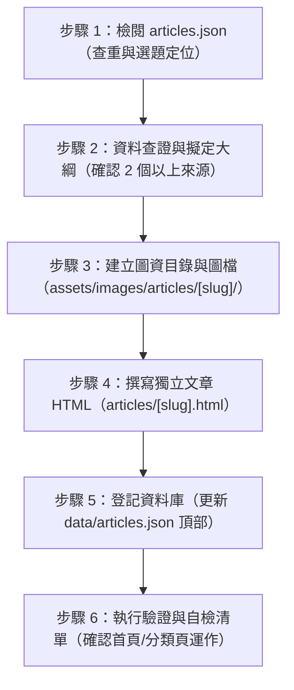
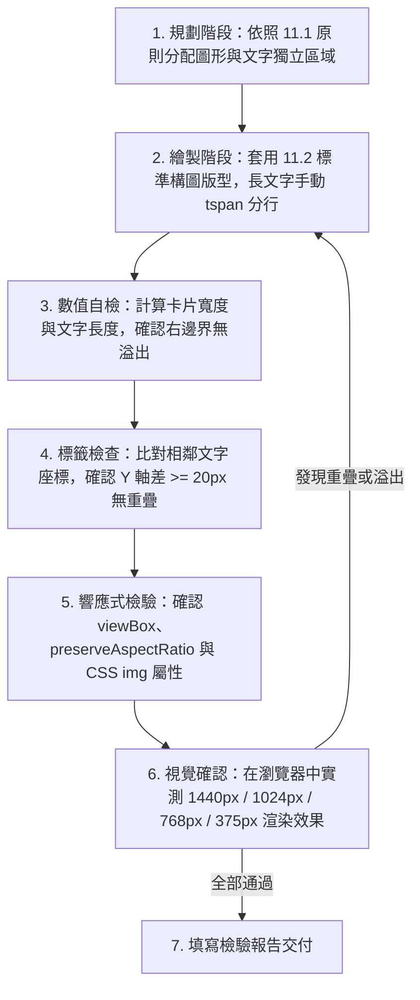

# AGENTS.md — THE STORY LAB（事物探索研究所）專案規則手冊

> 本文件為 AI 代理人（AI Agents）在維護、擴充與更新「THE STORY LAB（事物探索研究所）」網站時的最高遵循準則。所有內容新增、架構維護與樣式調整均須完全符合本手冊規範。

---

## 1. 專案目的與核心定位

### 1.1 核心理念
「THE STORY LAB（事物探索研究所）」是一個專注於**「探索日常事物背後故事」**的高質感線上內容平台。生活中的每件物品、符號、習慣與設計，都沉澱著人類文明、工藝演進與思維創新的痕跡。網站的核心目標是帶領讀者看見平凡事物中不平凡的設計與歷史。

### 1.2 三大內容支柱（Content Pillars）
網站文章必須平衡分佈於以下三個主要方向，分類代碼與英文名稱固定如下：
1. **Everyday Mysteries（日常事物，slug: `everyday-mysteries`）**
   - 探索日常用品、生活細節、不可思議的現象及其背後的科學、物理或製造原理。
   - 選題示例：原子筆鋼珠的微米工藝、微波爐轉盤的設計原理、易開罐拉環的槓桿歷史。
2. **Design & Creation（設計與創意，slug: `design-creation`）**
   - 介紹經典產品、建築、品牌識別、生活道具及其背後的設計哲學與創意思維。
   - 選題示例：Braun 計算機的十項原則體現、無印良品壁掛式 CD 播放器、地鐵路網圖的資訊設計。
3. **Origins & Stories（起源與故事，slug: `origins-stories`）**
   - 探討物品、品牌、文化習俗、符號標誌的歷史起源、演變過程與文化意涵。
   - 選題示例：藍色牛仔褲銅鉚釘的由來、條形碼在海灘上的靈感發想、公車站牌符號演進。

### 1.3 目標讀者與寫作調性
* **目標讀者**：一般大眾、對日常生活事物懷抱好奇心者、設計與文化愛好者。
* **語言規範**：
  * 主要語言為**繁體中文**（台灣習慣用語與全形標點符號）。
  * 網站主要功能標籤與分類名稱採「中文（英文）」或保留英文名稱以營造國際雜誌感。
* **文風要求**：
  * 口吻親切、知性、文字優雅且節奏分明。
  * **兼具雜誌專題深度與閱讀趣味，拒絕艱澀學術論文感，同時嚴厲禁止寫成浮淺零碎的農場冷知識**。

---

## 2. 技術架構與 GitHub Pages 相對路徑規範

### 2.1 技術選型與極限限制
* **純前端無依賴架構**：僅允許使用標準 **HTML5、CSS3、Vanilla JavaScript (ES6+)**。
* **零後端與零構建**：
  * 不得使用 Node.js、Python、PHP 等後端環境。
  * 不得依賴 Webpack、Vite、npm 等編譯工具（所有檔案開箱即可於瀏覽器運行）。
  * 不得使用需要付費或需 API Key 的外部服務。

### 2.2 相對路徑規則（防範 GitHub Pages 部署失效核心）
GitHub Pages 專案多部署於 Repository 子路徑（例如：`https://<username>.github.io/the-story-lab/`）。為保證在本地預覽與線上環境皆能正常加載，**路徑規則為本專案第一紅線**：

1. **嚴禁根目錄絕對路徑**：不得出現 `/assets/...`、`/data/...`、`/index.html`。
2. **嚴禁本機檔案路徑**：不得出現 `C:\...`、`file:///...`。
3. **分層相對路徑準則**：
   * **根目錄頁面（Level 0：`index.html`, `about.html`）**：
     * 樣式參照：`assets/css/style.css`
     * 資料載入：`data/articles.json`
     * 連結到分類：`categories/everyday-mysteries.html`
     * 連結到文章：`articles/[slug].html`
   * **子目錄頁面（Level 1：`categories/*.html`, `articles/*.html`）**：
     * 樣式參照：`../assets/css/style.css`、`../assets/css/article.css`
     * 資料載入：`../data/articles.json`
     * 連結回首頁：`../index.html`
     * 連結到其它分類：`../categories/[category-slug].html`
     * 圖片參照：`../assets/images/articles/[slug]/cover.webp`

### 2.3 JavaScript 動態路徑解析機制
在 `data/articles.json` 中，所有路徑統一以「專案根目錄」為基準儲存（如 `"assets/images/..."`、`"articles/slug.html"`）。
前端 JS 在渲染連結與圖片時，必須使用以下簡單標準邏輯取得層級前綴：
```javascript
// 取得當前頁面相對於專案根目錄的前綴
const PATH_PREFIX = window.location.pathname.includes('/categories/') || 
                    window.location.pathname.includes('/articles/') ? '../' : '';

// 範例：渲染圖片與超連結時自動疊加前綴
const imageUrl = PATH_PREFIX + article.cover_image;
const articleUrl = PATH_PREFIX + article.url;
```

---

## 3. 檔案與目錄結構

專案目錄從零建立，嚴格遵守以下樹狀層次：

```text
the-story-lab/
├── index.html                   # 網站首頁（焦點精選、最新文章、三大分類入口）
├── about.html                   # 關於本所（創立理念、編輯方針、授權宣告）
├── categories/                  # 分類彙整獨立頁面
│   ├── everyday-mysteries.html  # Everyday Mysteries 分類文章清單
│   ├── design-creation.html     # Design & Creation 分類文章清單
│   └── origins-stories.html     # Origins & Stories 分類文章清單
├── articles/                    # 獨立文章 HTML 存放區
│   ├── ballpoint-pen-secrets.html
│   └── [article-slug].html
├── data/
│   └── articles.json            # 核心文章資料庫（唯一來源真實資料）
├── assets/
│   ├── css/
│   │   ├── style.css            # 全域基礎變數、字型、導覽列、頁尾與首頁/分類頁版型
│   │   └── article.css          # 文章內頁專用排版、閱讀體驗與特殊內容模組樣式
│   ├── js/
│   │   ├── main.js              # 讀取 articles.json、渲染首頁焦點與分類頁卡片
│   │   └── article.js           # 文章頁功能（目錄跳轉、閱讀進度條、相關文章推薦）
│   └── images/
│       ├── brand/               # 網站標誌、Favicon、Hero 裝飾插圖
│       └── articles/
│           └── [article-slug]/  # 該文章專屬圖片資料夾（目錄名與 slug 完全一致）
│               ├── cover.webp   # 封面主圖（必備，建議 1200x675 以上，WebP 格式）
│               └── figure-1.webp# 內文圖（依序編號）
└── AGENTS.md                    # 本專案 AI 維護與擴充核心手冊
```

---

## 4. 集中式資料架構（`data/articles.json` 規範）

`data/articles.json` 是整個網站的索引核心。**新增任何文章，都必須在建立獨立 HTML 後，同步更新本檔案。**

### 4.1 JSON 資料結構範例

```json
[
  {
    "id": "ballpoint-pen-secrets",
    "slug": "ballpoint-pen-secrets",
    "title": "一公釐裡的極限工藝：原子筆滾珠的旋轉秘密",
    "subtitle": "為什麼這顆小小的碳化鎢鋼珠，曾是二戰後最難製造的日常奇蹟？",
    "category": "everyday-mysteries",
    "category_name": "Everyday Mysteries",
    "publish_date": "2026-11-15",
    "read_time": "5 MIN READ",
    "target_subject": "原子筆",
    "summary": "我們每天順暢書寫的背後，藏著一顆直徑不到 1 毫米、公差僅有幾十奈米的超精密滾珠。本文拆解原子筆滾珠如何解決漏墨世紀難題與其製造極限。",
    "url": "articles/ballpoint-pen-secrets.html",
    "cover_image": "assets/images/articles/ballpoint-pen-secrets/cover.webp",
    "cover_caption": "高倍率電子顯微鏡下的原子筆筆尖鋼珠與出墨導溝",
    "cover_credit": "Science Museum Group / CC BY-NC-SA 4.0",
    "tags": ["日常工藝", "製造秘密", "書寫工具"],
    "featured": true,
    "visual_theme": "scrapbook",
    "related_articles": [
      "safety-pin-origin",
      "swiss-army-knife-evolution"
    ]
  }
]
```

### 4.2 欄位功能與用途
| 欄位名稱 | 型態 | 說明與功能 |
| :--- | :--- | :--- |
| `id` / `slug` | 字串 | 唯一識別碼，採用英數連字符，與 HTML 檔名及圖片資料夾名稱相同。 |
| `title` | 字串 | 文章主標題，展示於卡片與社群預覽。 |
| `subtitle` | 字串 | 文章副標題，補充研究視角或核心懸念。 |
| `category` | 字串 | 必為 `everyday-mysteries`、`design-creation`、`origins-stories` 之一。 |
| `category_name` | 字串 | 前端顯示名稱，如 `"Everyday Mysteries"`。 |
| `publish_date` | 字串 | 發布日期，格式 `YYYY-MM-DD`（列表排序依據，最新在前）。 |
| `read_time` | 字串 | 預估閱讀時間，格式為 `"X MIN READ"`。 |
| `target_subject`| 字串 | **研究核心事物名稱（如「原子筆」、「長尾夾」），作為查重與關聯推薦的比對核心。** |
| `summary` | 字串 | 80~120 字精要導讀，用於首頁與分類卡片摘要。 |
| `url` | 字串 | 固定為 `"articles/[slug].html"`，前端透過 `PATH_PREFIX` 解析。 |
| `cover_image` | 字串 | 封面圖路徑，固定為 `"assets/images/articles/[slug]/cover.webp"`。 |
| `cover_caption`| 字串 | 封面圖片圖說。 |
| `cover_credit` | 字串 | 封面圖版權來源與授權條款。 |
| `tags` | 陣列 | 標籤陣列，用於次要過濾與關聯計算。 |
| `featured` | 布林 | 是否置於首頁大版面 Hero 焦點推薦（全站通常維持 1~2 篇為 true）。 |
| `visual_theme` | 字串 | **文章專屬視覺風格模板，必為 `scrapbook`、`refined`、`romantic`、`experimental` 之一。預設為 `scrapbook`。** |
| `related_articles`| 陣列 | 指定推薦文章的 slug 清單（若留空，JS 自動 fallback 至同分類最新文章）。 |

---

## 5. 文章新增規範與結構模板

每篇文章必須具有獨立的 HTML 頁面（`articles/[slug].html`），結構維持統一的編輯專題架構。

### 5.1 必備固定結構（6 大骨架）
1. **刊頭區（Article Header）**：英文分類膠囊、發布日期、閱讀預估時間、大主標、副標題、封面圖。
2. **引言區（Opening Hook）**：200~300 字，以日常生活觀察、觸覺、生活共鳴或反直覺疑問破題。
3. **核心速覽卡（Key Facts Box）**：以側邊欄或摘要卡呈現該事物的關鍵年代、代表發明者/設計師、核心材質/技術特點。
4. **深度內文（Main Story）**：1,200~2,000 字，拆分為 2~3 個帶有設計感副標題的章節，文字穿插圖片。
5. **探索者筆記（Curator’s Note）**：300 字以內，由編輯/策展人視角提出思辨，探討該事物對現代生活、習慣或美學的長遠啟示。
6. **參考資料（References）**：文末列出**至少 2 個具備可點擊超連結的可信參考來源**。

### 5.2 選用特殊內容模組（5 種彈性模組）
為防止文章千篇一律，AI 應依選題需要，挑選 1~2 個模組融入主體故事中：
* `module-timeline`（時間軸）：呈現歷史演進重大節點。
* `module-evolution`（設計演進）：呈現產品外型與結構不同世代的迭代。
* `module-comparison`（對比分析）：兩種技術路線或設計哲學的橫向剖析。
* `module-how-it-works`（原理拆解盒）：聚焦於機械結構或物理效應的圖文解說。
* `module-facts`（細節放大鏡）：補充 2~3 則不為人知的幕後冷知識或設計彩蛋。

### 5.3 獨立文章 HTML 標準結構模板
AI 在建立 `articles/[slug].html` 時，必須遵照以下語意化標準結構撰寫：

```html
<!DOCTYPE html>
<html lang="zh-Hant">
<head>
  <meta charset="UTF-8">
  <meta name="viewport" content="width=device-width, initial-scale=1.0">
  <title>文章主標題 — THE STORY LAB 事物探索研究所</title>
  <meta name="description" content="文章摘要80-120字">
  <!-- 字型引入 -->
  <link rel="preconnect" href="https://fonts.googleapis.com">
  <link rel="preconnect" href="https://fonts.gstatic.com" crossorigin>
  <link href="https://fonts.googleapis.com/css2?family=Noto+Sans+TC:wght@400;500;700&family=Noto+Serif+TC:wght@500;700;900&display=swap" rel="stylesheet">
  <!-- 樣式引用（相對路徑） -->
  <link rel="stylesheet" href="../assets/css/style.css">
  <link rel="stylesheet" href="../assets/css/themes.css">
  <link rel="stylesheet" href="../assets/css/article.css">
</head>
<body class="article-page" data-theme="scrapbook">
  <!-- 全域導覽列 -->
  <header class="site-header">
    <div class="header-container">
      <a href="../index.html" class="brand-logo">THE STORY LAB <span>事物探索研究所</span></a>
      <nav class="nav-links">
        <a href="../categories/everyday-mysteries.html">Everyday Mysteries</a>
        <a href="../categories/design-creation.html">Design & Creation</a>
        <a href="../categories/origins-stories.html">Origins & Stories</a>
        <a href="../about.html">About</a>
      </nav>
    </div>
  </header>

  <!-- 文章閱讀進度條 -->
  <div id="read-progress" class="read-progress-bar"></div>

  <!-- 文章主容器 -->
  <main class="article-container">
    <article class="article-content">
      <!-- 1. 刊頭區 -->
      <header class="article-header">
        <div class="meta-tag-group">
          <a href="../categories/everyday-mysteries.html" class="category-badge">Everyday Mysteries</a>
          <span class="publish-date">2026-11-15</span>
          <span class="read-time">5 MIN READ</span>
        </div>
        <h1 class="article-title">一公釐裡的極限工藝：原子筆滾珠的旋轉秘密</h1>
        <p class="article-subtitle">為什麼這顆小小的碳化鎢鋼珠，曾是二戰後最難製造的日常奇蹟？</p>
        
        <figure class="featured-figure">
          
          <figcaption>
            <span class="caption">顯微鏡下的原子筆筆尖鋼珠與出墨導溝。</span>
            <span class="credit">圖／Science Museum Group (CC BY-NC-SA 4.0)</span>
          </figcaption>
        </figure>
      </header>

      <!-- 2. 引言區 -->
      <section class="article-hook">
        <p>當你握起手邊最普通的一支原子筆在紙上劃下字跡時，你其實正在操控一具每秒能高速旋轉數千圈的微型滾珠軸承...</p>
      </section>

      <!-- 3. 核心速覽卡 -->
      <aside class="key-facts-box">
        <h3 class="box-title">Key Facts 速覽</h3>
        <ul class="facts-list">
          <li><strong>研究主體：</strong>原子筆筆尖滾珠（Ballpoint Tip）</li>
          <li><strong>成型年代：</strong>1938 年由 László Bíró 取得專利，1950 年代完善精密微珠</li>
          <li><strong>關鍵工藝：</strong>碳化鎢（Tungsten Carbide）球體、幾十奈米級圓度公差</li>
          <li><strong>核心突破：</strong>毛細現象與旋轉剪力配合的高黏度快乾油墨</li>
        </ul>
      </aside>

      <!-- 4. 主體故事 -->
      <div class="article-body">
        <section>
          <h2>世紀書寫難題：鋼筆為什麼無法隨心所欲？</h2>
          <p>在原子筆問世之前，人類習慣使用蘸水筆或吸墨式鋼筆...</p>
        </section>

        <!-- 選用特殊模組範例：原理拆解 -->
        <div class="module-how-it-works">
          <h4>【原理拆解】五個微米間隙如何阻擋墨水崩漏？</h4>
          <p>滾珠並非直接塞進管內，而是由五個微米級包覆爪扣住，當書寫受壓時...</p>
        </div>

        <section>
          <h2>一公釐的世界：奈米級公差的工藝極限</h2>
          <p>製造一顆滾珠並非難事，但製造數億顆直徑完全均勻、表面粗糙度接近鏡面的鋼珠...</p>
        </section>
      </div>

      <!-- 5. 探索者筆記 -->
      <section class="curator-note">
        <h3 class="note-title">Curator's Note 探索者筆記</h3>
        <p>我們常常讚嘆摩天大樓或太空梭的宏偉，卻容易忽略那些被壓進幾角錢台幣裡的極致工藝。原子筆告訴我們：最偉大的設計，往往是那些讓你感受不到它存在、卻默默承載世界運轉的生活細節。</p>
      </section>

      <!-- 6. 參考資料 -->
      <footer class="article-references">
        <h3>參考資料與延伸閱讀</h3>
        <ol class="references-list">
          <li>
            <a href="https://example.com/source-1" target="_blank" rel="noopener noreferrer">Bíró, László. "Writing Instrument Patent Record (US Patent 2,390,636)". United States Patent Office, 1945.</a>
          </li>
          <li>
            <a href="https://example.com/source-2" target="_blank" rel="noopener noreferrer">Petroski, Henry. "The Evolution of Useful Things". Vintage Books, 1994.</a>
          </li>
        </ol>
      </footer>
    </article>

    <!-- 相關文章推薦（由 article.js 自動依 articles.json 填入） -->
    <aside class="related-articles-section">
      <h3>探索更多背後故事</h3>
      <div id="related-posts" class="related-grid"></div>
    </aside>
  </main>

  <!-- 全域頁尾 -->
  <footer class="site-footer">
    <div class="footer-container">
      <p class="copyright">© 2026 THE STORY LAB（事物探索研究所）. All rights reserved.</p>
      <p class="tagline">探索生活背後的故事，看見平凡中的不平凡。</p>
    </div>
  </footer>

  <!-- 腳本引入 -->
  <script src="../assets/js/article.js"></script>
</body>
</html>
```

---

## 6. 資料查證與圖片資源規範

### 6.1 資料查證標準（嚴禁幻覺與捏造）
1. **來源資格要求**：每篇文章至少引用 **2 個具有公信力的參考資料**。
   * 第一優先：官方機構檔案庫、專利局公開文件、知名博物館典藏專文（MoMA、Smithsonian）。
   * 第二優先：權威文化與設計刊物（Dezeen, Wallpaper*, Designboom, BBC, NYT, 國家地理）。
   * 嚴格禁止：內容農場、匿名論壇、社交平台轉發截圖。
2. **多說法爭議處理**：遇歷史起源爭端（如發明權之爭），必須持平並列敘述，清楚標示「目前歷史學界有兩種主要文獻觀點」，不得武斷定論。

### 6.2 圖片取得、授權與存放規範
1. **圖片存放位置**：必須保存在專案目錄 `assets/images/articles/[article-slug]/` 內。
2. **圖檔命名**：
   * 封面大圖：固定為 `cover.webp`。
   * 內文附圖：固定為 `figure-1.webp`、`figure-2.webp`。
3. **授權條款嚴格確認**：
   * 僅限使用 **Public Domain（公有領域）**、**CC0** 或符合條件的 **Creative Commons（如 CC-BY, CC-BY-SA）** 授權圖片。
   * 可選用開源圖庫（Unsplash, Pexels, Wikimedia Commons, 國立圖書館/博物館開放資料庫）。
4. **圖說強制規定**：
   * 所有 HTML `<figure>` 標籤中，必須包含 `<figcaption>`。
   * 內含兩項資訊：**圖片內容說明（Caption）** 與 **來源/版權署名（Photo Credit）**。

---

## 7. 視覺設計系統：ONE BRAND, FOUR VISUAL IDENTITIES

THE STORY LAB 遵循**「同一個品牌，四種視覺風格（One Brand, Four Visual Identities）」**的核心設計哲學。我們維持一致的品牌識別與閱讀骨架，但允許不同文章根據主題氛圍、材質屬性與內容調性，選用四套固定視覺模板之一。

### 7.1 四套固定視覺模板定義

| 模板名稱 / 代碼 | 適用主題類型 | 固定色票 | 視覺風格與關鍵元素 |
| :--- | :--- | :--- | :--- |
| **01. Artistic Scrapbook**<br>`scrapbook` *(預設)* | 復古物件、手工藝、生活歷史、藝術展覽、隨性探索 | • Cream Paper: `#F3EBDD`<br>• Burgundy: `#8E2927`<br>• Vintage Blue: `#587D91`<br>• Forest Green: `#69745C`<br>• Dark Brown: `#493A34` | **歐陽娜娜音樂會海報／獨立 Zine 手作紙本感**。<br>撕紙邊緣、紙膠帶（Washi Tape）、郵戳章、印章、復古相片拼貼。有手繪感但不凌亂，保留舒適留白。 |
| **02. Refined**<br>`refined` | 品牌設計、建築、精工產品、材質美學、寂靜美學 | • Oatmeal: `#EAE4D8`<br>• Ivory: `#F7F5EF`<br>• Olive: `#69745C`<br>• Cocoa: `#655348`<br>• Charcoal: `#292927` | **高級靜謐質感與建築極簡主義**。<br>大量留白、1px 極細分割線、純淨幾何構圖、高品質攝影、優雅成熟的字體搭配。不堆疊任何手繪或蕾絲素材。 |
| **03. Romantic**<br>`romantic` | 香氛、美妝時尚、花卉園藝、生活儀式感、女性創作者 | • Cream: `#F5EEE8`<br>• Dusty Rose: `#C6A1A1`<br>• Berry Red: `#914B50`<br>• Champagne: `#D8C6A5`<br>• Dark Brown: `#493B38` | **法式文學沙龍與優雅復古手記**。<br>柔和花卉、典雅雙細線相框、細緻蕾絲邊、緞帶蝴蝶結、珍珠小圓點隔線。拒絕刺眼亮粉紅與俗艷過甜。 |
| **04. Experimental**<br>`experimental` | 科學物理、機械機構、心理學、創新專利、未來趨勢 | • Cold White: `#F2F3F1`<br>• Silver Gray: `#BFC4C5`<br>• Charcoal: `#25282B`<br>• Electric Blue: `#416E9B`<br>• Lime Accent: `#B6C66A` | **實驗室研究手冊與俐落資料圖解**。<br>精確網格系統、研究編號標記（如 `[DATA-01]`）、數據框線、螢光黃綠高對比標籤、理性明晰的現代編輯語言。 |

### 7.2 統一的品牌基礎骨架（不可變更之核心）
無論文章採用哪一套模板，以下元素必須全站一致，確保品牌辨識度不被割裂：
1. **Logo 與品牌刊頭**：`THE STORY LAB 事物探索研究所` 標誌與層級保持統一。
2. **導覽列（Site Navigation）**：頂部導覽列位置、高度、按鈕結構與互動邏輯完全一致。
3. **頁面寬度與網格**：全站主容器最大寬度為 `1160px`，文章長篇閱讀欄寬固定為 `680px ~ 720px`。
4. **文章必備骨架模組**：Header、Opening Hook、Key Facts、Main Story、Curator's Note、References、Related Posts 的順序結構不變。
5. **易讀性底線**：內文一律以清晰無襯線字體（Noto Sans TC）搭配 `1.85 ~ 2.0` 行高，嚴禁使用難以辨識的花體字作為長段正文。
6. **全域頁尾**：版權聲明、三大分類與規範連結一致。

### 7.3 配色與裝飾使用原則
* **嚴禁自創第五套配色**：每篇專題只能使用上述四套定義之色碼，禁止混搭未定義的色彩。
* **色彩佔比指導（65-20-15 法則）**：
  * **65% 基礎版面與留白**：淺色背景、內文深色、大方留白。
  * **20% 主題色系**：標題、邊界、卡片主體。
  * **15% 裝飾與視覺細節**：紙膠帶、戳章、高光標籤、點綴色。
* **克制原則**：裝飾元素必須配合內容，禁止為了漂亮而毫無意義地堆疊貼紙或素材。

### 7.4 文章風格選擇決策邏輯（AI Decision Rules）
在 `data/articles.json` 中，每篇文章必須填寫 `"visual_theme"` 欄位：
* **分類不等於風格**：三大分類（Everyday, Design, Origins）**不可**直接寫死對應風格。
  * *示例 A*：探討「香水前中後調的調香藝術」➜ 選擇 `romantic`。
  * *示例 B*：探討「牛仔褲五袋結構與淘金歷史」➜ 選擇 `scrapbook`。
  * *示例 C*：探討「百靈牌 Braun 計算機的減法哲學」➜ 選擇 `refined`。
  * *示例 D*：探討「微波爐磁控管與電磁波阻隔原理」➜ 選擇 `experimental`。
* **預設值**：若文章未特別宣告或無法判斷，一律套用預設風格 `scrapbook`。
* **風格預覽網址**：專案根目錄備有獨立的互動預覽頁面 `theme-preview.html`，可即時切換比對四套風格的視覺呈現。

---

## 8. 主題查重與內容擴充規範

### 8.1 查重判定標準
AI 在發想或被指派新主題時，必須檢視 `data/articles.json`：
1. **事物名稱（`target_subject`）比對**：確認該事物是否曾被介紹。
2. **關鍵字（`tags`）比對**：確認探討領域是否重疊過高。

### 8.2 允許多角度延伸原則
**同一個事物不禁止再次成為主題，但核心探討角度必須完全不同**：
* *良好示範*：
  * 文章 A（`everyday-mysteries`）：原子筆鋼珠的一公釐精密加工原理。
  * 文章 B（`origins-stories`）：原子筆在二戰時期由記者兄弟發明以取代漏墨鋼筆的商戰歷史。
* *禁止示範*：
  * 兩篇文章均以原子筆歷史為主要篇幅，僅改換標題與插圖。
* **區隔規範**：若同主題已有舊文，新文章的副標題與 Opening Hook 必須立即聲明本篇的特殊切入點。

---

## 9. AI 新增文章標準作業流程（SOP）

當使用者要求 AI 新增文章時，AI 必須嚴格按照以下順序操作，**絕不可只產出單一 HTML 檔案即交件**：



1. **步驟 1：查重與確認分類**
   * 閱讀 `data/articles.json`，核對 `target_subject`。
   * 選定三大分類之一，決定 URL slug。
2. **步驟 2：資料蒐集與擬定大綱**
   * 確認 2 處以上可靠文獻來源。
   * 決定必備 6 大骨架內容，並選定 1~2 個特殊模組（如 Timeline、How it works）。
3. **步驟 3：準備圖片資源**
   * 建立資料夾 `assets/images/articles/[slug]/`。
   * 放入確認版權合法的 `cover.webp` 與內文插圖，並備齊圖說與 Credit。
4. **步驟 4：撰寫文章 HTML**
   * 依照第 5.3 節模板建立 `articles/[slug].html`。
   * 嚴格核對所有 CSS/JS/圖片均使用 `../` 前綴之相對路徑。
5. **步驟 5：更新核心資料庫 `data/articles.json`**
   * 在 JSON 陣列最上方插入此文章的 metadata 物件。
   * 填寫完整 `related_articles` 或交由前端依分類自動推播。
6. **步驟 6：全站功能驗證**
   * 確保首頁（`index.html`）能動態讀取此新文章。
   * 確保對應的分類頁（`categories/[category].html`）能正確過濾並顯示此文章。

---

## 10. AI 交付前自檢清單（Quality Checklist）

AI 在回報任務完成前，必須逐項自主確認通過以下檢查：

- [ ] **相對路徑驗證**：HTML 檔案中絕無 `/assets` 開頭或 `C:\` 等本機路徑。子目錄頁面一律使用 `../`。
- [ ] **JSON 語法驗證**：`data/articles.json` 語法完全合法，所有字串符號皆成對，可順利被 `JSON.parse()` 解析。
- [ ] **雙向同步確認**：`articles/[slug].html` 已存在，且 `data/articles.json` 中已有對應紀錄。
- [ ] **版權與查證落地**：文末附有可點擊的來源連結（至少 2 筆），所有圖片皆附有 `<figcaption>` 圖說與 Credit。
- [ ] **資訊圖表九項防錯自檢**（見第 11 節）：
  1. 所有 SVG 是否有正確的 `viewBox` 與 `preserveAspectRatio`。
  2. 所有文字是否完整顯示，絕無依賴瀏覽器不存在的自動換行。
  3. 是否有文字彼此重疊（特別是雙向引線、標籤與圖形交界處）。
  4. 是否有文字超出圖表外框或子卡片邊界。
  5. 是否有文字被邊界截斷或裁切。
  6. 中英文混排寬度是否已充分預留，無字元覆蓋。
  7. 多卡並排時，卡片內文是否完全約束在所屬卡片內，絕無跨卡穿透。
  8. 圖表在各級縮放後各元素與標註是否依然清晰可辨。
  9. 桌面版（1440px/1024px）與行動版（768px/375px）是否皆無溢出破版與橫向捲軸。
- [ ] **視覺檢驗真實性**：嚴禁僅憑程式碼猜測視覺效果。必須啟動本地伺服器，盡可能透過瀏覽器進行視覺渲染確認；若環境受限無法截圖，必須如實說明已驗證的數值項目與未驗證的環境，不得虛假宣稱全部通過。
- [ ] **視覺風格與色票規範**：文章必須指定 `visual_theme` 模板（`scrapbook`、`refined`、`romantic`、`experimental` 之一，未指定預設為 `scrapbook`），嚴格限制僅使用該模板的五組固定色票，並遵循 65-20-15 的色彩與留白比例。

---

## 11. 全站資訊圖表（Infographics & SVG）排版規範與長期防錯機制

本節為專案所有資訊圖表（包含文章內嵌 SVG 圖表、資料視覺化卡片、原理拆解插圖與時間軸）的**長期硬性規範**。任何未來新增或修改之文章插圖，均必須嚴格落實本節標準，杜絕一切文字重疊、邊界溢出與裁切破版。

### 11.1 五大核心製作原則

#### 原則 1：文字與圖形必須分開規劃（分區定界原則）
製作 SVG 或圖表時，**絕對禁止先繪製圖形再將文字硬塞入剩餘狹縫**。繪製前必須在畫布上明確劃分五個獨立區域，並預留安全邊距（Margin）：
1. **圖表標題區（Header Zone）**：容納中英文主標題與圖表編號，留白至少 60–80px。
2. **圖形主體區（Graphic Zone）**：圖示、截面、機械結構的核心展示區，與周圍文字保留至少 20px 物理安全間隔。
3. **文字標籤區（Labels Zone）**：指向結構零件的專屬標註區，引線（Callout Lines）必須有明確的水平或垂直折線延伸，標籤文字置於引線外側，禁止漂浮壓在圖形本體上。
4. **說明文字區（Explanatory Text Zone）**：容納 2–4 行的原理說明，必須配置專屬的背景色盒（Sub-card Rect），賦予文字明確的排版邊界。
5. **圖片註解區（Footnote / Meta Zone）**：圖表底部結論或學術出處，與上方卡片保持充足間距。

#### 原則 2：嚴禁任何形式的文字重疊（Zero-Overlap Standard）
- **標籤與標籤之間**：垂直並排的多個標籤，其 Y 座標間距至少為 `字體大小 + 14px`。例如 11px 字體，相鄰文字 Y 軸差不得小於 25px。
- **標籤與圖形之間**：文字基線與邊緣禁止與任何幾何圖形、曲線、陰影或箭頭產生幾何相交。
- **文字與卡片邊界之間**：任何卡片內文字，其結尾 X 座標距離卡片右邊框至少保留 `15px` 的內距緩衝。
- **多欄卡片之間**：多卡並排時，每張卡片內的文字最大寬度不得超過 `卡片寬度 - 24px`，絕不允許文字延伸跨入隔壁卡片。
- **中英文混排檢查**：英文單字長度不一、中文全形字元寬度為 1em。計算寬度時，繁體中文字元以 `字級 × 1.05` 估算，英文字元以 `字級 × 0.65` 估算，標點符號與 Emoji（如 🧱、⏳）預留 1.2em，確保安全裕度。

#### 原則 3：SVG 嚴格換行與排版防錯規則
- **禁止單一 `<text>` 承載長句**：標準 SVG 1.1 的 `<text>` **不會自動換行**。長度超過 15 個繁體漢字的說明，**必須**使用多個 `<tspan>` 進行手動斷行。
- **`<tspan>` 標準換行寫法**：
  ```xml
  <!-- 正確示範：使用相同 x 起點與相對 dy 行距 -->
  <text x="24" y="30" font-family="'Noto Sans TC', sans-serif" font-size="11.5" fill="#5A473E">
    <tspan x="24" dy="0">第一行文字，長度控制在安全寬度之內，</tspan>
    <tspan x="24" dy="20">第二行文字以 dy='20' 平滑換行，</tspan>
    <tspan x="24" dy="20">第三行文字完美收錄於卡片框內。</tspan>
  </text>
  ```
- **嚴禁使用 HTML 專用標籤**：SVG 內部不得出現 `<strong>`、`<b>`、`<br>`、`<div>` 等無效標籤；如需強調，應使用 `<tspan font-weight="700">`。
- **嚴禁單純以 `overflow: hidden` 切除文字**：隱藏超出內容代表資訊缺損，必須透過重新調整構圖、分行或擴大畫布徹底解決。

#### 原則 4：內容呈現形式的最適選型矩陣
不要勉強將所有長篇內容全部硬塞進 SVG。應依照內容屬性選擇最合適的呈現形式：

| 內容屬性 | 最佳呈現形式 | 說明與規範 |
| :--- | :--- | :--- |
| **結構拆解、箭頭指引、微觀剖面** | **SVG 向量圖表** | 適合放置精確座標的零件名稱、簡短尺寸公差與動態流向。 |
| **長篇原理說明、論述、專訪脈絡** | **HTML 文字模組** | 使用 `.module-how-it-works` 或文章內文正文，享受瀏覽器原生自動折行與排版彈性。 |
| **多項並列細節、二選一對比** | **CSS Grid / Flexbox 卡片** | 使用 `.module-comparison` 或 HTML 卡片群，在手機端可自然折疊為單欄。 |
| **跨年代歷史演進** | **SVG 寬畫布或 HTML 時間軸** | 節點少於 5 個可使用寬畫布 SVG；節點多於 5 個時優先使用 HTML `.module-timeline`。 |
| **多階段複雜科學機制** | **分步圖解組或多卡並排 SVG** | 每個階段分配獨立卡片底板，確保說明文字與階段圖示 1 對 1 垂直對齊。 |

#### 原則 5：全尺寸響應式規範（Responsive Rules）
- **SVG 根標籤強制屬性**：
  ```xml
  <svg xmlns="http://www.w3.org/2000/svg" 
       viewBox="0 0 1020 530" 
       width="100%" 
       height="100%" 
       preserveAspectRatio="xMidYMid meet">
  ```
- **CSS 容器自適應約束**：
  所有包含 SVG 的圖片容器必須設定：
  ```css
  .article-figure img, .featured-figure img {
    width: 100%;
    max-width: 100%;
    height: auto;
    display: block;
    object-fit: contain;
  }
  ```
- **小螢幕最小可讀字級底線**：
  在基準 `viewBox` 寬度為 1000px 左右時，SVG 內最小字級不得低於 `10px`（次要英文註解），主說明文字不得低於 `11.5px`，卡片標題不得低於 `14px`。當在 375px 手機縮小檢視時，仍能維持結構輪廓與文字輪廓辨識度。

---

### 11.2 四大可重複使用之資訊圖表版型標準範本（Design Blueprints）

未來新增文章時，應優先套用以下四種經過幾何驗證的標準構圖版型，避免每次重新摸索間距：

#### 版型 A：左右雙欄結構對比型（Dual-Card Structural Blueprint）
- **適用場景**：一側為構造剖面圖解，另一側為機能細節清單（例如牛仔褲專利、珍珠成色機制）。
- **畫布推薦規格**：`viewBox="0 0 1020 530"`
- **幾何劃分**：
  - 左卡（Figure A）：`x=50, y=105, width=440, height=385`（剖面居中於 x=215, y=175；底部配 400×72px 說明盒）。
  - 右卡（Figure B）：`x=510, y=105, width=460, height=385`（三項細節垂直間距 70px；底部配 410×50px 小結盒）。
  - 中間留白間隔：`20px`。

#### 版型 B：多階段水平橫向卡片型（Multi-Stage Flow Blueprint）
- **適用場景**：4 步物理/化學連續機制（例如雨後氣膠四階段噴射、蒸餾分離過程）。
- **畫布推薦規格**：`viewBox="0 0 1060 520"`
- **幾何劃分**：
  - 4 張卡片：寬度均為 `230px`，高度 `375px`。
  - 卡片起點 X 座標依序為：`x=40`、`x=290`、`x=540`、`x=790`（均勻間距 20px，左右外邊距 40px）。
  - 內部繪圖區：`y=155`（高度 110px 居中）。
  - 底部說明盒：`x=14, y=270, width=202, height=85`（文字 3 行，每行約 10–12 字）。

#### 版型 C：直角座標系與動態連續曲線型（Coordinate Curve Blueprint）
- **適用場景**：揮發率、溫度、壓力、濃度隨時間或環境變化的連續動態（例如香水三調揮發曲線）。
- **畫布推薦規格**：`viewBox="0 0 960 500"`
- **幾何劃分**：
  - 座標系起點：`(100, 400)`，終點：`(880, 400)`（寬度 780px，高度 300px）。
  - Y 軸標籤置於 `(100, 92)`；X 軸箭頭標籤置於軸線末端上方 `(880, 392)`，**絕不與 X 軸時間刻度重疊**。
  - 時間刻度獨立行：置於 `y=420`。
  - 曲線浮動標籤：卡片寬度至少 `205px`，高度 `28px`，文字垂直居中。
  - 底部提示卡：置於左下方 `(100, 442)`，與 X 軸保留足夠垂直落差。

#### 版型 D：歷史年代時間軸型（Timeline Nodes Blueprint）
- **適用場景**：5 個歷史節點媒介或技術演變（例如從驛站到 Email）。
- **畫布推薦規格**：`viewBox="0 0 1120 540"`
- **幾何劃分**：
  - 5 張年代卡片：寬度均為 `195px`，高度 `325px`。
  - 卡片起點 X 座標依序為：`x=35`、`x=250`、`x=465`、`x=680`、`x=895`（間距 20px）。
  - 年代節點圓點：置於時間軸線 `y=110` 上；年份文字置於圓點上方 `y=94`。
  - 卡片內部各條目（延遲、載體、階層、特點）垂直間距 `24px`，特點說明盒寬度 `167px`。
  - 底部思考長橫條：寬度 `1055px`，置於 `y=470`，內文 1–2 行居中。

---

### 11.3 文章新增後的固定防錯檢驗執行流程（Checklist Execution SOP）

未來任何 AI 在為 THE STORY LAB 製作新文章或更新圖表時，**必須執行以下檢驗循環，確認 100% 通過後方可回報完成**：



**檢驗承諾**：若當前環境可使用瀏覽器進行視覺化檢視，AI 必須實際檢查渲染效果；若環境不支援或未進行真實像素檢視，必須在回報中明確聲明「已通過幾何座標數值計算驗證，尚待視覺終端實測」，嚴禁虛假宣告已全部通過視覺實測。

---
*本手冊由「THE STORY LAB（事物探索研究所）」專案制定，為後續一切開發與文章擴充之最高指導文件。*
